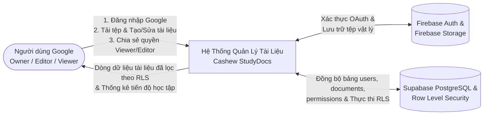
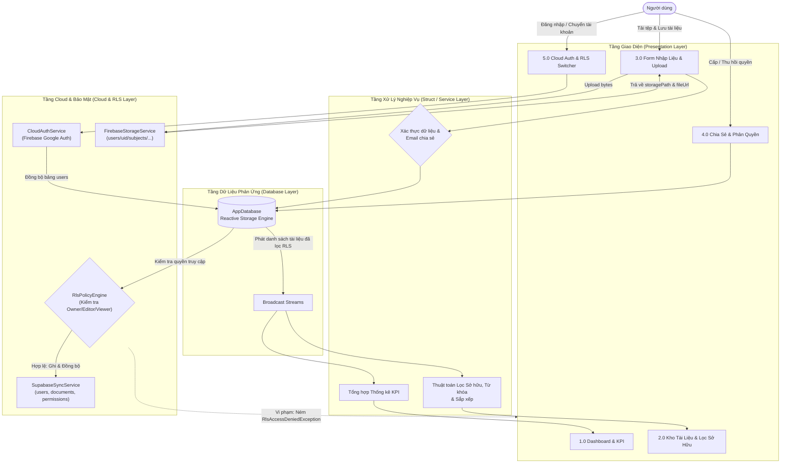
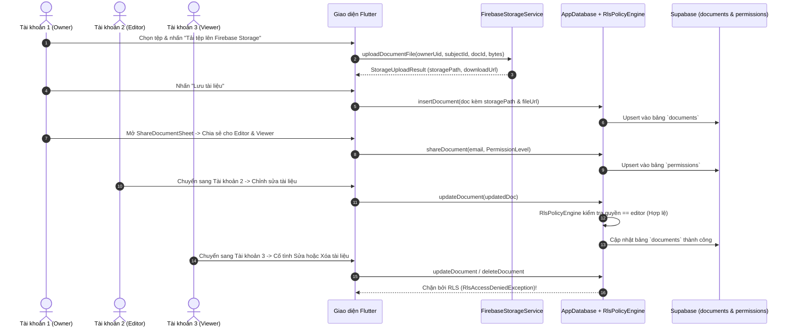
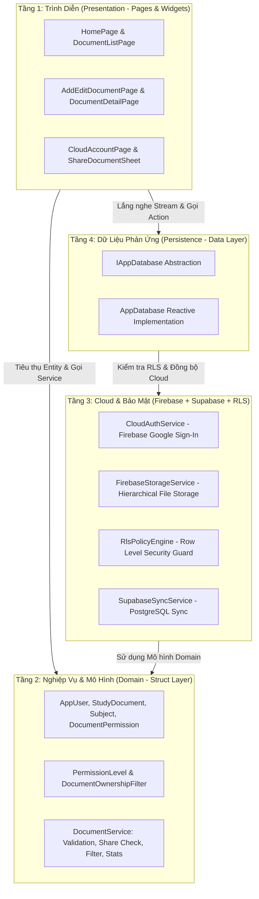
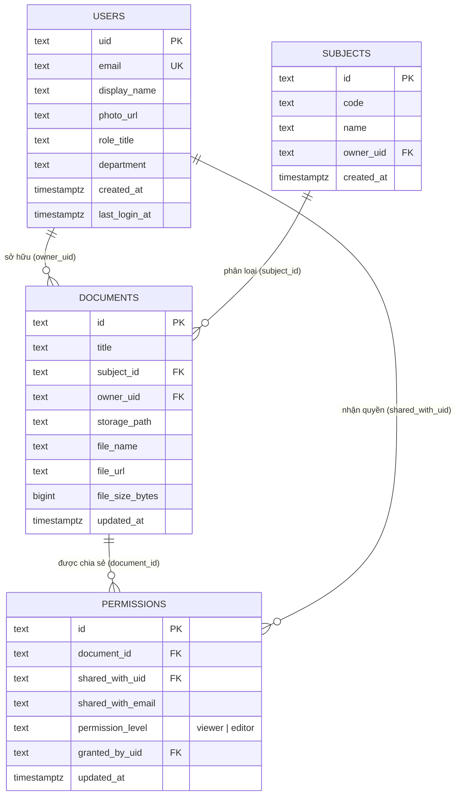

# BÁO CÁO THIẾT KẾ VÀ TRIỂN KHAI HỆ THỐNG
## ỨNG DỤNG QUẢN LÝ TÀI LIỆU HỌC TẬP (CASHEW STUDYDOCS CLOUD)
### Áp dụng Nguyên lý Kiến trúc Phân tầng Cashew & Hệ sinh thái Cloud (Firebase Auth + Firebase Storage + Supabase RLS)

---

## 1. Phân Tích Yêu Cầu Chức Năng & Luồng Dữ Liệu

### 1.1. Yêu cầu chức năng (Functional Requirements)
Ứng dụng được thiết kế nhằm phục vụ sinh viên, giảng viên và trợ giảng quản lý, lưu trữ đám mây và chia sẻ an toàn các tài nguyên học tập với 4 nhóm tài liệu chính:
* **Bài giảng (Lectures / Slides):** Lưu trữ tài liệu học tập lý thuyết, ghi chú theo chương, liên kết tải slide PDF/PPTX từ Firebase Storage.
* **Bài tập & Đồ án (Assignments / Projects):** Quản lý bài tập về nhà, bài tập lớn, theo dõi hạn nộp (Deadline), trạng thái xử lý (*Chưa làm*, *Đang làm*, *Đã hoàn thành*) và cảnh báo quá hạn.
* **Tài liệu tham khảo (References):** Sách giáo trình, bài báo nghiên cứu, tài liệu hướng dẫn kỹ thuật, liên kết ngoài.
* **Đề cương & Đề thi (Exams / Reviews):** Đề cương ôn tập giữa kỳ/cuối kỳ, ngân hàng câu hỏi, đề thi mẫu.

**Các chức năng cốt lõi & Nâng cấp Cloud:**
1. **Xác thực Người dùng Google (Firebase Authentication + Google Sign-In):**
   * Đăng nhập bằng tài khoản Google thông qua `FirebaseAuth` và `GoogleSignIn`.
   * Tự động đồng bộ hồ sơ người dùng (`uid`, `email`, `display_name`, `photo_url`, `role_title`, `department`) vào bảng `users` trên Supabase.
   * Hỗ trợ chuyển đổi nhanh giữa nhiều tài khoản Google để kiểm chứng phân quyền.
2. **Lưu trữ Tệp Vật lý trên Firebase Storage & Quản lý Tài liệu (CRUD):**
   * **Cấu trúc lưu trữ phân cấp chuẩn trên Firebase Storage:**
     `users/{owner_uid}/subjects/{subject_id}/documents/{document_id}/{file_name}`
   * **Thêm mới & Tải tệp (Create & Upload):** Xác thực dữ liệu đầu vào, tải tệp vật lý lên Firebase Storage và tự động gắn `storage_path`, `file_url`, `file_size_bytes` vào bảng `documents` trên Supabase.
   * **Cập nhật (Update):** Chỉnh sửa thông tin, thay thế tệp đính kèm, đổi trạng thái hoàn thành nhanh (chỉ cho phép `owner` hoặc `editor`).
   * **Xóa (Delete):** Chỉ Chủ sở hữu (`owner`) được phép xóa tài liệu; tự động xóa dây chuyền bản ghi phân quyền trên Supabase và tệp vật lý trên Firebase Storage.
3. **Chia sẻ Tài liệu & Phân quyền Truy cập An toàn (Supabase Permissions & Row Level Security - RLS):**
   * Chủ sở hữu chia sẻ tài liệu cho người dùng khác qua địa chỉ Email Google với 2 cấp độ quyền:
     * **Chỉ xem (`viewer`):** Được phép xem chi tiết và tải tệp tài liệu; bị chặn mọi thao tác chỉnh sửa, xóa hoặc chia sẻ tiếp.
     * **Chỉnh sửa (`editor`):** Được phép xem, tải tệp và cập nhật thông tin/trạng thái tài liệu; bị chặn thao tác xóa tài liệu, chiếm quyền sở hữu (`owner_uid`) hoặc quản lý danh sách chia sẻ.
   * Chủ sở hữu có thể nâng/hạ cấp quyền (`viewer` $\leftrightarrow$ `editor`) hoặc thu hồi quyền truy cập (`revokePermission`) bất cứ lúc nào.
4. **Tìm kiếm & Bộ lọc Đa tiêu chí (Search & Ownership Scope Filtering):**
   * **Lọc theo phạm vi quyền truy cập:** *Tất cả tài liệu được phép xem*, *Tài liệu của tôi (`ownedByMe`)*, *Được chia sẻ với tôi (`sharedWithMe`)*.
   * **Tìm kiếm thời gian thực (Live Search):** Khớp từ khóa trên tiêu đề, mô tả, tên môn học, thẻ `#tags`, tên/email chủ sở hữu và đường dẫn tệp Storage.
5. **Dashboard Thống kê & Theo dõi Tiến độ (Study KPI & Metrics):**
   * Biểu đồ tiến độ hoàn thành bài tập tổng thể, thống kê số lượng tài liệu sở hữu và tài liệu được chia sẻ.

---

### 1.2. Sơ đồ Luồng Dữ liệu (Data Flow Diagrams - DFD)

#### Sơ đồ DFD Mức 0 (Context Diagram)
Mô tả sự tương tác giữa Đa người dùng (Chủ sở hữu, Người chỉnh sửa, Người xem) với Hệ thống Quản lý Tài liệu Học tập và Hệ sinh thái Cloud:



#### Sơ đồ DFD Mức 1 (Detailed Data Flow Diagram)
Mô tả dòng luồng dữ liệu chi tiết giữa các tầng giao diện, tầng nghiệp vụ, tầng bảo mật RLS và dịch vụ Cloud:



#### Sơ đồ Tuần tự (Sequence Diagram): Luồng Tải Tệp lên Firebase Storage, Chia sẻ Tài liệu & Kiểm tra RLS



---

## 2. Thiết Lập Cấu Trúc Thư Mục Chuẩn Kiến Trúc Cashew (Mở Rộng Cloud)

Cấu trúc dự án kế thừa mô hình phân tầng của **Cashew** (`f:\Flutter\Cashew\budget`) và mở rộng thêm phân hệ `lib/cloud/`, `supabase/` và `firebase/`:

```text
study_document_manager/
├── firebase/
│   └── storage.rules                     # Quy tắc bảo mật Firebase Storage theo đường dẫn phân cấp
├── supabase/
│   └── migrations/
│       └── 001_supabase_schema_and_rls.sql # Định nghĩa bảng PostgreSQL (users, subjects, documents, permissions) & RLS Policies
├── lib/
│   ├── colors.dart                       # Hệ thống màu Material 3, Dark/Light Palette chuẩn Cashew
│   ├── main.dart                         # Điểm khởi tạo Firebase, Supabase, Database & MultiProvider
│   │
│   ├── cloud/                            # TẦNG CLOUD & BẢO MẬT (FIREBASE + SUPABASE + RLS)
│   │   ├── cloud_config.dart             # Cấu hình FirebaseOptions, Storage Bucket & Supabase Keys
│   │   ├── auth_service.dart             # Đăng nhập Google qua Firebase Auth & đồng bộ bảng `users`
│   │   ├── storage_service.dart          # Lưu trữ tệp vật lý trên Firebase Storage & gắn kết bảng `documents`
│   │   ├── rls_policy_engine.dart        # Bộ thực thi chính sách bảo mật Row Level Security (RLS)
│   │   └── supabase_sync_service.dart    # Đồng bộ dữ liệu quan hệ trực tiếp với Supabase Client
│   │
│   ├── database/                         # TẦNG 1: PERSISTENCE & DATA ACCESS LAYER
│   │   ├── tables.dart                   # Định nghĩa Schema 4 bảng: UsersTable, SubjectsTable, DocumentsTable, PermissionsTable
│   │   ├── app_database.dart             # Database Engine tích hợp RLS, Reactive Streams, Sharing & Cascade Delete
│   │   ├── database_global.dart          # Biến toàn cục database theo pattern chuẩn của Cashew
│   │   └── default_preview_data.dart     # Khởi tạo 4 tài khoản Google mẫu, 4 môn học, 7 tài liệu & 11 bản ghi phân quyền
│   │
│   ├── struct/                           # TẦNG 2: DOMAIN MODELS & BUSINESS LOGIC LAYER
│   │   ├── models.dart                   # Thực thể AppUser, StudyDocument, Subject, DocumentPermission, PermissionLevel
│   │   ├── document_service.dart         # Pure Use Cases: Validation, Share Validation, Ownership Filter, Sort, KPI
│   │   ├── settings.dart                 # Cấu hình người dùng (ThemeMode, Sort Preferences) qua ChangeNotifier
│   │   └── formatters.dart               # Định dạng ngày thân thiện, kích cỡ tệp, xử lý văn bản
│   │
│   ├── widgets/                          # TẦNG 3: REUSABLE PRESENTATION ATOMS & MOLECULES
│   │   ├── document_card.dart            # Thẻ tài liệu hiển thị huy hiệu quyền RLS, chủ sở hữu & dung lượng Cloud
│   │   ├── share_document_sheet.dart     # Bottom Sheet quản lý chia sẻ tài liệu & phân quyền Viewer/Editor
│   │   ├── subject_badge.dart            # Huy hiệu môn học với chấm màu và bo góc viền nhận diện
│   │   ├── priority_indicator.dart       # Huy hiệu mức độ ưu tiên trực quan
│   │   ├── status_chip.dart              # Chip trạng thái tích hợp PopupMenu thay đổi tiến độ
│   │   ├── filter_bottom_sheet.dart      # Bottom Sheet đa tiêu chí lọc
│   │   ├── search_bar_widget.dart        # Thanh tìm kiếm với nút xóa nhanh và chỉ báo bộ lọc
│   │   ├── summary_card.dart             # Card tổng quan KPI tiến độ và các khối chỉ số học tập
│   │   └── empty_state.dart              # Giao diện hiển thị khi danh sách trống
│   │
│   └── pages/                            # TẦNG 4: FEATURE VIEWS & FLOW CONTROLLERS
│       ├── home_page.dart                # Màn hình Dashboard tổng quan, nút tài khoản Google & 5 tab điều hướng
│       ├── document_list_page.dart       # Màn hình kho tài liệu với chip lọc Tất cả / Của tôi / Được chia sẻ
│       ├── add_edit_document_page.dart   # Màn hình tạo/sửa tài liệu tích hợp nút tải tệp lên Firebase Storage
│       ├── document_detail_page.dart     # Màn hình chi tiết tài liệu, thẻ phân quyền RLS & đường dẫn Storage
│       ├── subjects_page.dart            # Màn hình quản lý môn học & cascade delete
│       ├── search_page.dart              # Màn hình tìm kiếm thời gian thực chuyên sâu
│       └── cloud_account_page.dart       # Màn hình quản lý Google Auth, hạ tầng Cloud & chuyển đổi đa tài khoản RLS
│
└── test/                                 # BỘ KIỂM THỬ KIẾN TRÚC & ĐA TÀI KHOẢN RLS TOÀN DIỆN
    ├── database_test.dart                # Kiểm thử tầng Data Layer: CRUD, Stream Reactivity, Cascade Delete
    ├── document_service_test.dart        # Kiểm thử tầng Struct/Service: Validation, Filter, Sort, Statistics
    ├── architecture_separation_test.dart # Kiểm thử tính độc lập giữa các tầng, Mocking, DIP
    ├── cloud_multi_account_rls_test.dart # Kiểm thử Google Auth, Firebase Storage & RLS trên 4 tài khoản khác nhau
    └── widget_test.dart                  # Kiểm thử giao diện Dashboard, Form, Search & Chuyển đổi tài khoản Cloud RLS
```

---

## 3. Phân Tích Sự Phân Tách Các Lớp & Thiết Kế Cơ Sở Dữ Liệu Cloud

### 3.1. Sơ đồ Phân tầng Kiến trúc Mở rộng Cloud



### 3.2. Thiết kế Cơ sở Dữ liệu Quan hệ trên Supabase & Chính sách Bảo mật RLS



**Ma trận Phân quyền Row Level Security (RLS Policies):**

| Thao tác (Operation) | Chính sách RLS (`001_supabase_schema_and_rls.sql`) | Chủ sở hữu (`owner`) | Người chỉnh sửa (`editor`) | Người xem (`viewer`) | Người ngoài (`none`) |
| :--- | :--- | :---: | :---: | :---: | :---: |
| **Xem & Tìm kiếm (`SELECT`)** | `documents_select_owner_or_shared` | Cho phép | Cho phép | Cho phép | **Chặn (RLS)** |
| **Tạo tài liệu (`INSERT`)** | `documents_insert_owner_only` | Cho phép (`owner_uid = self`) | — | — | **Chặn (RLS)** |
| **Cập nhật & Tải tệp (`UPDATE`)** | `documents_update_owner_or_editor` | Cho phép | Cho phép (Không được đổi `owner_uid`) | **Chặn (RLS)** | **Chặn (RLS)** |
| **Xóa tài liệu (`DELETE`)** | `documents_delete_owner_only` | Cho phép | **Chặn (RLS)** | **Chặn (RLS)** | **Chặn (RLS)** |
| **Chia sẻ & Thu hồi quyền (`SHARE`)** | `permissions_insert_document_owner_only` | Cho phép | **Chặn (RLS)** | **Chặn (RLS)** | **Chặn (RLS)** |

---

## 4. Báo Cáo Kết Quả Kiểm Thử Đa Tài Khoản & Phân Tầng (Verification Report)

### 4.1. Kịch bản Kiểm thử Đa Tài khoản (4 Tài khoản Google khác nhau)
Hệ thống được kiểm thử tự động và trực quan với 4 tài khoản người dùng đại diện cho đầy đủ các vai trò trong thực tế:
1. **Tài khoản 1 (`uid_user_1` — `an.nguyen@edu.vn`):** TS. Nguyễn Văn An (*Giảng viên — Chủ sở hữu tài liệu gốc `owner`*).
2. **Tài khoản 2 (`uid_user_2` — `binh.tran@edu.vn`):** ThS. Trần Thị Bình (*Trợ giảng — Được chia sẻ quyền chỉnh sửa `editor`*).
3. **Tài khoản 3 (`uid_user_3` — `cuong.le@edu.vn`):** Lê Hoàng Cường (*Sinh viên K18 — Được chia sẻ quyền chỉ xem `viewer`*).
4. **Tài khoản 4 (`uid_user_4` — `dung.pham@edu.vn`):** Phạm Minh Dũng (*Sinh viên lớp ngoài — Kiểm chứng cô lập dữ liệu `none`*).

### 4.2. Tổng hợp Kết quả Thực thi Bộ Kiểm thử (`flutter test` & `flutter analyze`)

| Test File | Phạm vi kiểm thử | Số ca test | Trạng thái |
| :--- | :--- | :---: | :---: |
| `test/architecture_separation_test.dart` | Kiểm chứng tính độc lập giữa các tầng, Mocking `IAppDatabase`, DIP, toàn vẹn dữ liệu | **3/3** | **PASSED** (100%) |
| `test/cloud_multi_account_rls_test.dart` | Đăng nhập Google 4 tài khoản, Upload Firebase Storage, Chia sẻ tài liệu, Chặn RLS (Viewer/Editor/Outsider) & Toàn vẹn dữ liệu liên tài khoản | **3/3** | **PASSED** (100%) |
| `test/database_test.dart` | Khởi tạo, Thêm, Sửa, Xóa, Khóa ngoại, Cascade Delete, Reactive Stream, Yêu thích | **8/8** | **PASSED** (100%) |
| `test/document_service_test.dart` | Xác thực tài liệu/môn học, Lọc từ khóa, Lọc kết hợp, Sắp xếp đa tiêu chí, Thống kê KPI, Bóc tách tag | **10/10** | **PASSED** (100%) |
| `test/widget_test.dart` | Dashboard, Điều hướng 5 Tabs, Tạo tài liệu mới, Tìm kiếm thời gian thực & Chuyển đổi 3+ tài khoản Google trên Tab Cloud & RLS | **4/4** | **PASSED** (100%) |
| **TỔNG CỘNG** | **Toàn bộ hệ thống (Static Analysis: `No issues found!`)** | **28/28** | **PASSED (100%)** |

**Kết quả thực thi lệnh kiểm thử thực tế:**
```text
$ flutter analyze
Analyzing study_document_manager...
No issues found!

$ flutter test
00:00 +0: loading test/architecture_separation_test.dart
00:00 +3: test/cloud_multi_account_rls_test.dart: 1. Xác thực Google (Firebase Auth) và đồng bộ 4 tài khoản người dùng trên bảng `users` (Supabase)
00:00 +4: test/cloud_multi_account_rls_test.dart: 2. Cấu trúc lưu trữ tệp vật lý trên Firebase Storage và kết nối với bảng `documents` trên Supabase
00:00 +5: test/cloud_multi_account_rls_test.dart: 3. Luồng phân quyền RLS toàn diện trên 4 tài khoản: Cô lập dữ liệu, Chia sẻ Viewer/Editor và Toàn vẹn dữ liệu
00:00 +14: test/database_test.dart: Chuyển đổi trạng thái yêu thích (toggleFavorite)
00:00 +23: test/document_service_test.dart: Trích xuất tags thông minh từ nội dung văn bản
00:00 +24: test/widget_test.dart: Kiểm thử giao diện ứng dụng Cashew StudyDocs: Hiển thị Dashboard và điều hướng Tabs
00:02 +25: test/widget_test.dart: Kiểm thử tạo tài liệu mới qua AddEditDocumentPage
00:02 +26: test/widget_test.dart: Kiểm thử tìm kiếm trên màn hình Kho tài liệu
00:03 +27: test/widget_test.dart: Kiểm thử Tab Cloud & RLS: Chuyển đổi giữa 3+ tài khoản Google và cập nhật quyền truy cập
00:04 +28: All tests passed!
```

---

## 5. Hướng Dẫn Cài Đặt, Cấu Hình Cloud & Chạy Ứng Dụng

1. **Di chuyển vào thư mục dự án & Cài đặt thư viện:**
   ```bash
   cd f:\Flutter\Cashew\study_document_manager
   flutter pub get
   ```
2. **Thiết lập Cơ sở dữ liệu & RLS trên Supabase:**
   * Mở trình **SQL Editor** trên Supabase Dashboard và chạy toàn bộ nội dung tệp [`supabase/migrations/001_supabase_schema_and_rls.sql`](file:///f:/Flutter/Cashew/study_document_manager/supabase/migrations/001_supabase_schema_and_rls.sql).
   * Áp dụng quy tắc bảo mật [`firebase/storage.rules`](file:///f:/Flutter/Cashew/study_document_manager/firebase/storage.rules) trên Firebase Console $\rightarrow$ Storage $\rightarrow$ Rules.
3. **Chạy kiểm tra chất lượng mã nguồn & bộ kiểm thử tự động:**
   ```bash
   flutter analyze
   flutter test
   ```
4. **Khởi chạy ứng dụng (Hỗ trợ cả chế độ Cloud thực tế qua `--dart-define` và chế độ Sandbox Đa Tài khoản tích hợp sẵn):**
   ```bash
   flutter run -d windows
   # Hoặc truyền khóa Supabase/Firebase thực tế:
   # flutter run --dart-define=SUPABASE_URL=https://your-project.supabase.co --dart-define=SUPABASE_ANON_KEY=your-anon-key
   ```
